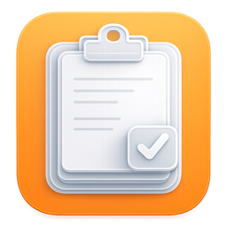

# PasteX

<p align="center">
  
</p>

PasteX is a native macOS clipboard history manager focused on quick retrieval, rich previews, and local storage.

The interface uses SwiftUI and AppKit. SQLite history is managed by an isolated actor, with image payloads loaded on demand. No backend services or third-party dependencies are required.

## Highlights

- Clipboard history with search, date groups, pinned items, and list or board views.
- Text, links, code, JSON, email, colors, images, and optional file references.
- Inline inspector or a separate preview panel, with syntax highlighting and type-specific actions.
- Color swatches, HEX/RGB copying, JSON formatting, and URL opening.
- Menu bar access, recent clips, configurable global shortcuts, and launch at login.
- Local retention limits and confirmation before clearing pinned items.

## Requirements

- macOS 15 or later.
- Xcode with a macOS SDK supporting the deployment target.
- No third-party dependencies or backend services.

## Development

1. Open `PasteX.xcodeproj` in Xcode.
2. Select the `PasteX` scheme and your Mac.
3. For a signed build, choose your own Team under Signing & Capabilities.
4. Build and run. PasteX lives in the menu bar.

## Build

For a Release build without signing:

```sh
xcodebuild -project PasteX.xcodeproj -scheme PasteX \
  -configuration Release CODE_SIGNING_ALLOWED=NO build
```

Launch at login requires a correctly signed application. Install the app in `/Applications` before enabling it for daily use.

Build products are written to Xcode's DerivedData directory. Local builds target the architecture of the build machine.

## Quality Checks

The [GitHub Actions workflow](.github/workflows/build.yml) compiles Release and runs the SQLite regression checks. See [docs/testing.md](docs/testing.md) for the local test commands and manual UI checklist.

## Shortcuts

| Action | Default |
| --- | --- |
| Open PasteX | Shift + Command + V |
| Compact search | Option + Command + K |
| Copy one of the nine most recent items, while PasteX is active | Command + 1 ... 9 |
| Settings | Command + comma |

Global shortcuts can be changed in Settings. Clicking an item opens its preview; use the row's copy button to copy its contents.

## History Storage

PasteX works entirely on the Mac: no account, server connection, cloud sync, analytics, or device token is needed. Opening a saved URL launches the default browser.

History is stored in `~/Library/Application Support/PasteX/PasteX.sqlite3`. SQLite may create adjacent `-wal` and `-shm` files. Preferences are stored separately in the app's user defaults. Image payloads are loaded on demand.

The local database is **not encrypted**. Clipboard history can contain sensitive information: use the sensitive-content filter and retention settings accordingly. Filtering is heuristic and cannot identify every secret. Existing history from earlier versions remains readable; legacy sync tables are left untouched but are no longer used.

Clipboard capture checks `NSPasteboard.general.changeCount` every 750 milliseconds. It skips transient/concealed pasteboard types and suppresses the app's own copies. Very fast successive copies between checks may be missed.

## Architecture

```text
NSPasteboard changeCount
          |
          v
 PasteboardMonitor -> classification and hashing
          |
          v
 ClipboardViewModel -> ClipboardDatabase (SQLite actor)
          |
          v
 SwiftUI history / inspector / compact search
```

```text
PasteX/
  Components/   Reusable controls and AppKit bridges
  Data/         Explicitly loaded sample items
  Models/       Clipboard values and display modes
  Persistence/  Actor-isolated SQLite history
  Services/     Clipboard capture, detection, shortcuts, login items, windows
  ViewModels/   Clipboard state and preferences
  Views/        History, previews, search, and settings
```

`PasteXApp` assembles the app; `ClipboardViewModel` coordinates local capture and persistence. `ClipboardDatabase` serializes SQLite access through an actor. `PasteboardMonitor` reads the system pasteboard on the main actor.

## Security

Clipboard history is local and unencrypted. Sensitive-content detection is best effort. Review history before sharing your Mac or diagnostic exports. Build products, clipboard databases, signing certificates, and local environment files must not be committed.

## Contributing

Keep changes focused and follow the existing SwiftUI and actor boundaries. Run the Release build and database checks before opening a pull request; include manual verification notes for UI changes.

## License

MIT. See [LICENSE](LICENSE).
